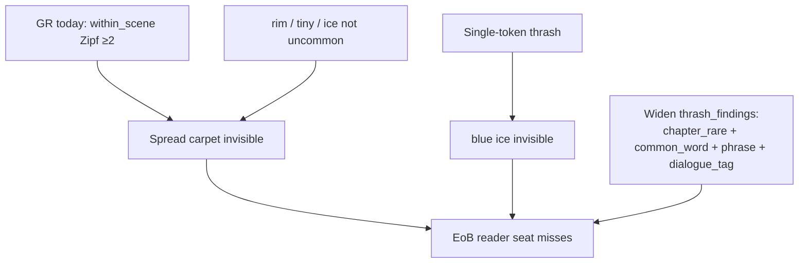
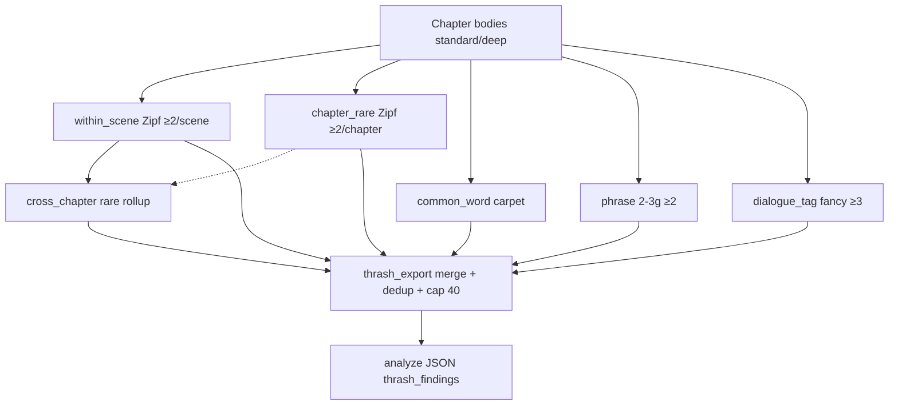

# Design: Full analyze — robust reader-visible thrash (compose Autonomicon #355)

| Field | Value |
| --- | --- |
| **Author** | GhostReader craft design (Grok Build) |
| **Date** | 2026-10-15 |
| **Status** | Draft rev 3 (mermaid fuse ≥3 aligned → awaiting re-review 0 open) |
| **Plan / design run id** | `1ef981df` |
| **Issue** | [Shinran7/Ghostreader#10](https://github.com/Shinran7/Ghostreader/issues/10) — Full analyze: robust reader-visible thrash (compose Autonomicon #355) |
| **Parent / compose** | Autonomicon [#355](https://github.com/deftai/Autonomicon/issues/355) thrash/overuse/phrases (`design-17f15406-355-thrash-overuse-phrases.md`); GhostReader / Autonomicon [#285](https://github.com/deftai/Autonomicon/issues/285) EoB Zipf thrash (`8c6c4513` / `thrash_detector.py`) |
| **Evidence** | Issue #10 body; Autonomicon `stories/the-resonance-between-us/reports/thrash-scan-ch1-3.md`; density/thrash lab gap (scene-window quiet, chapter carpet loud) |
| **Repos** | GhostReader primary (`C:\Users\shinr\Projects\Ghostreader`); Autonomicon read-only reference (`C:\Users\shinr\Projects\Autonomicon`) |
| **Scratch** | `C:\Users\shinr\AppData\Local\Temp\grok-shinr\grok-design-doc-1ef981df.md` |
| **Summary scratch** | `C:\Users\shinr\AppData\Local\Temp\grok-shinr\grok-design-summary-1ef981df.md` |
| **Durable land (S0)** | `docs/plans/design-1ef981df-10-analyze-thrash-355.md` |
| **Delivery** | Direct-to-`master` YOLO slices. No `gh pr create`. "## PR Plan" = ordered master commits / Meeseeks slices. |
| **Voice** | Zinsser for Overview / Goals / Key Decisions. Paths and function names stay concrete for implementers. |
| **Keep** | Existing Zipf `thrash_findings` seat (#285). Soft `prose.uncommon_thrash` deferred (KD-4). Autonomicon mid-stream avoid/ledger/#355 write combat untouched. Sticky Resonance-class fixtures only. No story rewrite as closeout. |
| **Proof** | Unit/golden fixtures without live LLM. Dual-stop **2 fails / ~90m** per slice. S1 pure no-op wire (never `NotImplemented`). |

**Compose surfaces (do not fork a parallel mystery ledger):**

- `ghostreader/analyzers/thrash_detector.py` — Zipf uncommon; `within_scene` ≥2; `cross_chapter` rollup; `COMMON_ENGLISH`; `lemma` / `is_uncommon`; Zipf sync with Autonomicon
- `ghostreader/report/thrash_export.py` — `analyze_thrash_findings`; kinds filter; cap; severity sort
- `ghostreader/cli.py` — `thrash_enabled = analyze_thrash_watch ∧ depth ∈ {standard, deep}`
- `ghostreader/config.py` — `analyze_thrash_watch`, `analyze_thrash_findings_cap`
- `ghostreader/report/ANALYZE_HOOK.md` + `json_export.py` (`ANALYZE_JSON_VERSION` today `0.2.0`)
- `ghostreader/analyzers/repetition_detector.py` + `report/repetition_export.py` — TF-IDF / dialogue-tag sibling; do not crown as #355 substitute
- Autonomicon (read-only): `polish_uncommon_noun_thrash.py` (`chapter_rare_*`), `common_word_overuse.py`, `phrase_thrash.py`, `dialogue_tag_thrash.py`, `docs/plans/design-17f15406-355-thrash-overuse-phrases.md`

---

## Overview

GhostReader’s full analyze should catch what a careful reader notices. Today Zipf thrash only fires when an uncommon lemma hits twice inside one scene. Spread carpet across scenes stays quiet. Ordinary words like `rim` and `tiny` never enter the Zipf seat. Multi-word setting phrases like `blue ice` never enter a single-token detector. Fancy attribution tags like `muttered` can carpet a chapter while bare `said` stays invisible noise.

Autonomicon #355 closed the rare/common/phrase gap on the write path, with #341 owning muttered demote. GhostReader is the reader/analyze seat. It must widen those smells — plus fancy-tag carpet — into machine `thrash_findings` for end-of-book cleanup. Not invent a second ledger. Not replace Autonomicon’s mid-stream combat.

**Recommendation (locked in Key Decisions):** Compose and widen existing `thrash_findings`. Keep `within_scene` / `cross_chapter`. Add **four** kinds: `chapter_rare`, `common_word`, `phrase`, and `dialogue_tag` (never bare `said`). Autonomicon-aligned rare/common/phrase fuses; fancy-tag fuse ≥3 to catch Resonance Ch1-class muttered×3. Soft `prose.uncommon_thrash` stays deferred. Full analyze is the delivery surface; companion thrash is an optional later slice.

---

## Background & Motivation

### Operator locks (#10)

| Lock | Meaning |
| --- | --- |
| Reader-visible thrash | Full analyze must notice patterns a real reader would catch |
| Compose #355 | Chapter-scope rare fuse + common-word carpet + literary multi-word phrase thrash |
| One ledger | Widen Zipf `thrash_findings` (#285 / `thrash_detector.py`); do not fork a parallel mystery array |
| Analyze first | Full analyze is the priority; companion may get a thinner progressive slice later (not required to close) |
| Noise floor | Do not crown character names or bare `said` as primary thrash |
| Sticky fixtures | Resonance-class specimens in tests only; no story rewrite as closeout |
| Soft dim | Soft `prose.uncommon_thrash` may stay deferred if algorithmic rows are strong (existing KD-4) |
| Seat split | Do not replace Autonomicon #355 mid-stream avoid/ledger — GR is the reader/analyze seat |

### What GhostReader does today (verified)

| Surface | Path | Behavior | Gap for #10 |
| --- | --- | --- | --- |
| Zipf thrash detect | `ghostreader/analyzers/thrash_detector.py` | Uncommon lemma ≥2 **per scene** → `within_scene`; rollup ≥2 chapters → `cross_chapter` | Chapter-spread rares (1×/scene) never fire; Zipf-blind commons quiet |
| Thrash export | `ghostreader/report/thrash_export.py` | Merge within+cross; kinds allowlist `within_scene` \| `cross_chapter`; cap 40 | No room for common/phrase/chapter-rare/`dialogue_tag` kinds |
| CLI gate | `ghostreader/cli.py` ~L382–400 | `analyze_thrash_watch` ∧ depth standard/deep | Wire stays; payload too thin |
| Config | `ghostreader/config.py` | `analyze_thrash_watch: true`, `analyze_thrash_findings_cap: 40` | Keep; no new mystery kill unless needed |
| Hook | `ghostreader/report/ANALYZE_HOOK.md` | Documents thrash kinds as within/cross only; soft dim deferred | Needs additive kind docs + contract bump |
| Repetition | `repetition_detector.py` / `repetition_export.py` | TF-IDF words/phrases; analyze never emits `dialogue_tag` | Blunt repeats; not Zipf / not #355 literary carpet |
| Companion | `ghostreader/companion/*` | `repetition_findings` + soft craft; **no** `thrash_findings` | Issue confirms MISSING; out of required closeout |
| Soft prose | TypeSafe/LLM five-pack | `prose.repetition` / `prose.vocabulary` | Must not overload for Zipf/#355 thrash (same lesson as #7 / #285) |

### Autonomicon #355 seats (read-only reference)

| Seat | Path | Locked numbers / contract | GR use |
| --- | --- | --- | --- |
| Chapter rare | `polish_uncommon_noun_thrash.chapter_rare_*` | Soft issue when uncommon lemma count ≥2 **across chapter**; first foothold legal | Port detect spirit into analyze rows |
| Common overuse | `common_word_overuse.py` | ABS ≥6 **or** ≥1.2/1000w (rate only if ≥1000 words and count ≥4); LB ABS 10 / 1.8/1000w; skip Zipf-uncommon, exempts, SI, muttered when #341 on | Port detect; GR is report-only (no avoid list) |
| Phrase thrash | `phrase_thrash.py` | Adjacent 2–3 content grams; fuse ≥2 (LB ≥3); stopword edges skipped | Port detect |
| Dialogue tags | `dialogue_tag_thrash.py` | Attribution muttered / fancy-tag scarcity (write demote often at cap 2) | Compose into GR `kind=dialogue_tag` (fuse ≥3); skip fancy lemmas from `common_word`; never bare `said` |
| Write avoid/ledger | `thrash_avoid_ledger.py`, Writer prompts | Mid-stream coaching | **Out of scope** for GR #10 |

### Specimen evidence (Resonance Ch1–3)

From Autonomicon `stories/the-resonance-between-us/reports/thrash-scan-ch1-3.md` after #355 seats:

- Chapter-rare rares fire (`knuckle`, `bulkhead`, `monolith`, `slab`, …) where scene ≥2 was quiet.
- Common carpet is loud (`hauler`, `ice`, `rim`, …) — Zipf will never own these.
- Phrase thrash includes literary pairs (`blue ice`, `ancient ice`, …) plus some procedural noise (`forty meter`, `five minute`) GR must demote via SI / structural skips where cheap.
- Companion/analyze historically surfaced blunt repetition and occasional jargon — not this #355-class robustness.



### Why not “just lower scene fuse to 1”

First uncommon use in a scene is legal world-building (#280 / #285 / #355). The smell is the **second** use — often in a later scene of the same chapter. Lowering scene fuse to 1 bans footholds. Scope must widen; first hit stays quiet.

---

## Goals & Non-Goals

### Goals

1. **Chapter-scope rare:** Uncommon lemmas that hit ≥2 times in a chapter (even 1× per scene) appear in analyze `thrash_findings`.
2. **Common-word carpet:** Reader-visible ordinary content overuse (`rim`, `tiny`, `flat`, `hauler` class) appears as thrash rows, distinct from Zipf rarity.
3. **Phrase thrash:** Literary multi-word setting phrases (`blue ice`, `spidered canopy` class) appear when repeated ≥2 in a chapter.
4. **Fancy dialogue-tag carpet:** Attribution-family lemmas (`muttered`, `whispered`, …) appear as `kind=dialogue_tag` when chapter count ≥3; bare `said` / `says` / `say` never emit.
5. **One machine ledger:** All four additive smells extend `thrash_findings` via `thrash_export` — no parallel array, no soft-dim dependency.
6. **Noise floor:** Character names and bare `said` never become primary thrash; structural / SI junk demoted or skipped; fancy-tag lemmas skip `common_word` (one smell, one seat).
7. **Full analyze delivery:** standard/deep when `analyze_thrash_watch` is on; kill-off / `quick` → `[]` unchanged.
8. **Proof:** Sticky Resonance-class fixtures; dual-stop 2/~90m; no live-LLM CI gate; no story rewrite closeout.

### Non-Goals

- Replacing Autonomicon #355 mid-stream avoid, ledger, Writer coaching, or Editor punch-list.
- Shipping density-lab A/B prompt experiments inside GhostReader.
- Treating character names / bare `said` as primary thrash.
- Soft `prose.uncommon_thrash` TypeSafe/LLM dim in this ticket (stays deferred).
- Required companion `thrash_findings` progressive slice (optional follow-up only).
- Rewriting Resonance / Shatterbound chapters as closeout.
- Forking a second muttered empire that ignores Autonomicon #341 / GR dialogue-tag stats.
- Changing Zipf vendor sync obligation (#285 KD-5) beyond documenting compose.
- **Local-window content thrash (Autonomicon #359 `local_word_thrash`, multi-sense `dog` class):** stays Autonomicon-only; out of GR #10.

---

## Key Decisions

| ID | Decision | Rationale |
| --- | --- | --- |
| **KD-1** | **Widen `thrash_findings`, do not fork.** New kinds live in the same analyze array and export path (`thrash_detector` helpers + `thrash_export`). No `thrash_findings_v2`, no overload of `repetition_findings` for #355 literary carpet. | Operator lock; Autonomicon already consumes `thrash_findings` for EoB. |
| **KD-2** | **Four additive kinds + two existing.** Keep `within_scene` and `cross_chapter`. Add `chapter_rare`, `common_word`, `phrase`, and `dialogue_tag`. Document in `ANALYZE_HOOK.md`. | #355 rare/common/phrase plus #10 muttered specimen as its own seat; never bare `said`. |
| **KD-3** | **Chapter rare fuse (locked):** Count Zipf-uncommon lemmas across a full chapter body (after frontmatter strip). Emit `chapter_rare` when count ≥2. Prefer **not** double-emitting the same lemma+chapter when a `within_scene` row already covers that lemma in that chapter (within_scene wins; chapter_rare only for spread misses). First single hit stays quiet. | Closes Resonance scene-quiet / chapter-loud gap; preserves foothold. |
| **KD-4** | **Soft `prose.uncommon_thrash` stays deferred.** Algorithmic rows are the v1 action surface. Do not overload `prose.vocabulary` / `prose.repetition`. | Existing #285 KD-4; operator lock #10. |
| **KD-5** | **Common-word thresholds (locked to Autonomicon S4 numbers):** ABS ≥6 **or** (word_n ≥1000 ∧ count ≥4 ∧ per_1000 ≥1.2). Load-bearing / protected higher bar ABS 10 / 1.8 per 1000 when a protect set is supplied (v1 protect set may be empty or names-only). Skip: Zipf-uncommon (rare path owns), length &lt;3, reader exempt set (KD-6), proper-name heuristic, thin SI length-unit set, **and the fancy-tag frozenset owned by `dialogue_tag` (KD-7)** so muttered never double-fires as `common_word`. | rim×N is craft failure Zipf never sees; stay aligned with #355 + #341 one-seat compose. |
| **KD-6** | **Reader noise floor (locked):** Never flag bare `said` / `says` / `say`. Skip proper-name heuristic (same spirit as thrash mid-sentence Title Case). Exempt a **reader structural set** = Autonomicon `_FREQUENCY_EXEMPT_WORDS` spirit ∪ high-noise function leftovers (`across`, `before`, `already`, `where`, `while`, `onto`, cardinals/`three`/`four`/…, `minute`/`hour` as bare time units). Names from Title Case heuristic are not primary thrash. | Operator: avoid crowning name/`said` noise; Resonance scan shows structural spam. |
| **KD-7** | **Muttered / fancy tags (compose, locked):** Separate `kind=dialogue_tag`. Fancy family = GR `_DIALOGUE_VERBS` lemmas minus `{said, asked, replied, answered}` (lock exact frozenset in S3). Fire when chapter count ≥ **3** (fixture against Resonance Ch1-class muttered×3). Intentionally quieter than Autonomicon write-path demote-at-2 (#341 default mutter cap). Never emit `said` / `says` / `say`. **Skip the same fancy frozenset from `common_word`** (KD-5) so one smell has one seat. Cap dialogue_tag rows inside the shared thrash cap. | Issue #10 + Resonance Ch1 muttered×3; compose #341 without double-seat or said noise. |
| **KD-8** | **Phrase thrash (locked):** Port Autonomicon `phrase_thrash` adjacency rules: 2–3 content tokens, each len≥3, no stopword edges, gap ≤2 chars. Fuse ≥2 per chapter. Normalize case/hyphen lightly (same `_norm_token` spirit). Skip SI-heavy procedural grams when both tokens are numeric+unit shaped (`forty meter`, `five minute`) via a thin rejector — literary `blue ice` / `spidered canopy` must still fire. | Multi-word blind today; keep literary signal. |
| **KD-9** | **Merge / cap / severity (locked):** Single `analyze_thrash_findings` merges all kinds. Cap default **40** (`analyze_thrash_findings_cap`). Sort: severity → kind priority → −count → key. Kind priority: `within_scene` → `chapter_rare` → `phrase` → `dialogue_tag` → `common_word` → `cross_chapter`. Severity: high ≥4 (or ≥8 for common_word), moderate ≥2 (common_word ≥6), else low — lock exact common_word bands in S3 fixtures. Dedup key: `(kind, normalized_key, chapter)` for chapter-scoped; cross_chapter unchanged. | One ledger; keep EoB actionable under cap. |
| **KD-10** | **Cross-chapter rollup (locked):** Keep existing Zipf `aggregate_cross_chapter` over **within_scene** rows. Optionally also roll `chapter_rare` lemmas that thrash in ≥2 chapters into `cross_chapter` (same kind) when no within_scene rollup exists for that lemma — **do not** invent `cross_chapter_common` in v1. Common/phrase stay chapter-local rows (chapters list length 1) unless a later ticket asks for book carpet rollup. | Avoid exploding kinds; motif rollup stays Zipf-rare. |
| **KD-11** | **Contract bump `ANALYZE_JSON_VERSION` → `0.2.1`.** Additive thrash kinds + hook docs. Consumers that ignore unknown kinds stay safe. No package `__version__` bump unless operator asks. Companion brief contract unchanged. | Additive machine surface; mirrors minor analyze bumps. |
| **KD-12** | **Module shape (locked):** Keep Zipf core in `thrash_detector.py`. Add thin helpers either as functions in that module **or** sibling `ghostreader/analyzers/common_word_thrash.py` + `phrase_thrash.py` that only feed `thrash_export` — public product remains one `thrash_findings` list. Prefer sibling modules if `thrash_detector.py` size hurts review; export still owns merge. | Compose without a parallel product array. |
| **KD-13** | **Analyze-only v1.** Companion thrash export is **optional follow-up** (slice marked deferred). Closing #10 does not require companion `thrash_findings`. | Operator priority lock. |
| **KD-14** | **Fixtures-only sticky exemplars.** Vend synthetic Resonance-class snippets under `tests/fixtures/thrash/` (e.g. `rim` carpet, `blue ice`×2, chapter-spread `firn`/`basalt` 1×/scene×2, muttered×N, name/`said` negative). Do not require Autonomicon checkout for CI. No live manuscript rewrite. | Sticky fixtures-only rule. |
| **KD-15** | **Delivery / proof.** YOLO master; S1 pure no-op wire never `NotImplemented`; dual-stop 2 fails / ~90m; no `gh pr create`. | House YOLO + design rules. |
| **KD-16** | **SI skip without Autonomicon import.** GR vendors a tiny local frozenset of SI length/time unit lemmas (`meter`/`meters`/`metre`/`kilometer`/`inch`/`inches`/… + `minute`/`minutes`/`hour`/`hours` as unit tokens) for common_word and phrase rejectors. Do not import Autonomicon at runtime. | Keep GR standalone; cut `forty meter` false primary. |

---

## Proposed Design

### 1. Detect — chapter rare

Extend Zipf path (same `is_uncommon` / `COMMON_ENGLISH` / vendor):

```text
detect_chapter_rare(content, chapter_number) -> list[ThrashFinding(kind="chapter_rare")]
```

- Strip frontmatter via `strip_chapter_body`.
- Count uncommon lemmas across whole chapter (reuse `_iter_candidate_tokens` over full body **or** sum per-scene counts without requiring ≥2 in one scene).
- Emit when count ≥2.
- Quote: first foothold surface via `quote_from_text`.
- Fields: reuse `ThrashFinding` with `kind="chapter_rare"`, `chapter`, `chapters=[n]`, `scene_index=None` (or first scene that held a hit), `foothold_token`, `later_surfaces`.

**Dedup with within_scene:** In `analyze_thrash_findings`, after collecting within_scene rows, drop `chapter_rare` rows whose `(lemma, chapter)` already appears in within_scene for that chapter.

### 2. Detect — common_word

New thin detector (sibling module or thrash helpers):

```text
detect_common_word_thrash(content, chapter_number) -> list[ThrashFinding(kind="common_word")]
```

- Tokenize with thrash `_TOKEN_RE` / `lemma`.
- Skip per KD-5 / KD-6 / KD-16.
- Skip if `is_uncommon(lemma)` True.
- **Skip the fancy-tag frozenset** owned by `dialogue_tag` (KD-7) — same set GR `_DIALOGUE_VERBS` minus `{said, asked, replied, answered}` — so `muttered` never emits both `common_word` and `dialogue_tag`.
- Thresholds per KD-5.
- `normalized_key` = lemma; `lemma` is always a non-null string for this kind.

### 3. Detect — phrase

```text
detect_phrase_thrash(content, chapter_number) -> list[ThrashFinding(kind="phrase")]
```

- Port Autonomicon adjacency n-gram logic (read-only copy; do not runtime-import).
- Fuse ≥2; SI/procedural rejector (KD-8 / KD-16).
- **Dataclass lock:** `ThrashFinding.lemma: str | None = None` and `phrase: str | None = None`. For `kind=phrase`, set `phrase` to the normalized multi-word string and leave `lemma` as `None`. JSON projection emits both keys (`lemma: null`, `phrase: "blue ice"`). `normalized_key` always set (phrase text for this kind).

### 4. Detect — dialogue_tag (thin)

```text
detect_dialogue_tag_thrash(content, chapter_number) -> list[ThrashFinding(kind="dialogue_tag")]
```

- Count fancy-tag lemmas from a frozenset aligned with GR `_DIALOGUE_VERBS` minus `{said, asked, replied, answered}` (lock set in S3).
- Fire when count ≥ **3** in chapter (fixture against Resonance Ch1-class muttered×3). Quieter than Autonomicon write-path demote-at-2 on purpose.
- Never emit `said` / `says` / `say`.
- This is thrash-shaped attribution carpet for EoB, not a rewrite of `repetition_findings` (analyze still omits dialogue_tag there).

### 5. Export merge

Update `ghostreader/report/thrash_export.py`:

1. If not enabled → `[]`.
2. Per chapter: within_scene (existing), chapter_rare, common_word, phrase, dialogue_tag.
3. Dedup chapter_rare vs within_scene (KD-3).
4. `aggregate_cross_chapter` on within_scene (+ optional chapter_rare orphans per KD-10).
5. `finding_to_dict` → allowlist kinds expanded.
6. Sort (KD-9) → cap.

`cli.py` call site stays the same signature.

### 6. Row shape (analyze JSON)

Additive fields stay backward compatible; unknown kinds ignored by old consumers.

| Field | Notes |
| --- | --- |
| `kind` | `within_scene` \| `cross_chapter` \| `chapter_rare` \| `common_word` \| `phrase` \| `dialogue_tag` |
| `lemma` | `str \| null` — required non-null for single-token kinds; **`null` when `kind=phrase`** |
| `phrase` | Multi-word normalized phrase when `kind=phrase`; else null |
| `count` | Hits |
| `chapters` / `chapter` / `scene_index` | As today; chapter-local kinds set `chapter` |
| `severity` | high / moderate / low |
| `quote` | Verbatim surgical span |
| `normalized_key` | lemma or phrase key |
| `foothold_token` / `later_surfaces` | Rare kinds; optional empty for common/phrase |

### 7. Flow



### 8. Tests / fixtures

Under `tests/fixtures/thrash/`:

| Fixture | Assert |
| --- | --- |
| `chapter-spread-firn.md` | `firn` once in two blank-line scenes → `chapter_rare` fires; no false within_scene if truly 1×/scene |
| `within-scene-firn.md` | existing ≥2/scene → `within_scene`; no duplicate `chapter_rare` |
| `rim-carpet.md` | `rim` ×6+ → `common_word`; `said` ×20 quiet; Title Case name mid-sentence quiet |
| `blue-ice-phrase.md` | `blue ice` ×2 → `phrase`; split non-adjacent `blue` … `ice` quiet |
| `muttered-tags.md` | `muttered` ×3 → `dialogue_tag`; `said` never; muttered does **not** also appear as `common_word` |
| `si-noise.md` | `forty meters` spam does not crown primary thrash |

Extend `tests/test_thrash_detector.py` + export tests in `tests/test_report.py`.

### 9. Docs

- Update `ghostreader/report/ANALYZE_HOOK.md` for kinds + `0.2.1`.
- Bump `ANALYZE_JSON_VERSION` in `json_export.py`.
- Note Zipf sync still applies (`ghostreader/data/README.md`); #355 compose is detect-port, not vendor fork.
- Optional one-liner pointer in Autonomicon plans (not required to close GR #10).

---

## API / Interface Changes

### CLI

No new subcommand. Existing:

```text
ghostreader analyze <path> --depth standard --format json
```

Gates unchanged: `analyze_thrash_watch` (default true) and depth ∈ `{standard, deep}`.

### Config

No new required knobs for v1. Optional follow-ups (not required):

| Knob | Default | Role |
| --- | --- | --- |
| `analyze_thrash_watch` | `true` | Existing master kill → `[]` |
| `analyze_thrash_findings_cap` | `40` | Existing shared cap across all thrash kinds |

Do **not** add three separate kills unless operator asks (keeps one ledger).

### Analyze JSON (`0.2.1`) example

```json
{
  "ghostreader_version": "0.2.1",
  "thrash_findings": [
    {
      "kind": "within_scene",
      "lemma": "firn",
      "phrase": null,
      "severity": "moderate",
      "count": 3,
      "chapters": [1],
      "chapter": 1,
      "scene_index": 0,
      "quote": "The firn cracked. She kicked the firn aside.",
      "normalized_key": "firn",
      "foothold_token": "firn",
      "later_surfaces": ["firn", "Firn"]
    },
    {
      "kind": "chapter_rare",
      "lemma": "basalt",
      "phrase": null,
      "severity": "moderate",
      "count": 2,
      "chapters": [1],
      "chapter": 1,
      "scene_index": null,
      "quote": "lifted off the basalt rim",
      "normalized_key": "basalt",
      "foothold_token": "basalt",
      "later_surfaces": ["basalt"]
    },
    {
      "kind": "common_word",
      "lemma": "rim",
      "phrase": null,
      "severity": "moderate",
      "count": 9,
      "chapters": [1],
      "chapter": 1,
      "scene_index": null,
      "quote": "off the basalt rim",
      "normalized_key": "rim",
      "foothold_token": "rim",
      "later_surfaces": []
    },
    {
      "kind": "phrase",
      "lemma": null,
      "phrase": "blue ice",
      "severity": "moderate",
      "count": 2,
      "chapters": [1],
      "chapter": 1,
      "scene_index": null,
      "quote": "boots crunching into the coarse blue ice",
      "normalized_key": "blue ice",
      "foothold_token": "blue",
      "later_surfaces": []
    },
    {
      "kind": "dialogue_tag",
      "lemma": "muttered",
      "phrase": null,
      "severity": "moderate",
      "count": 3,
      "chapters": [1],
      "chapter": 1,
      "scene_index": null,
      "quote": "Hollis muttered from the stove",
      "normalized_key": "muttered",
      "foothold_token": "muttered",
      "later_surfaces": []
    }
  ]
}
```

### Companion

No v1 API change. Optional later: project a thinner thrash slice into companion JSON (new brief minor bump) — **out of required PR Plan**.

---

## Data Model Changes

| Artifact | Change |
| --- | --- |
| `ThrashFinding` | Allow new kinds; `lemma: str \| None = None`; `phrase: str \| None = None` |
| `finding_to_dict` / thrash export allowlist | Expand kinds; emit `phrase` |
| `ANALYZE_JSON_VERSION` | `0.2.0` → `0.2.1` |
| `ANALYZE_HOOK.md` | Document new kinds + noise floor |
| `GhostreaderConfig` | No required new fields |
| `ReportOutput.thrash_findings` | Unchanged type (`list[dict]`); richer rows |
| Companion brief | No change in v1 |
| Autonomicon mid-stream | No change |

---

## Alternatives Considered

### A1. Overload `repetition_findings` instead of widening thrash

- **Pros:** One Autonomicon promote path already exists for repetition.
- **Cons:** Mixes TF-IDF tics with Zipf/#355 literary carpet; analyze already forbids `dialogue_tag` there; breaks the #285 thrash contract Autonomicon EoB skill expects.
- **Decision:** Reject. Widen `thrash_findings` (KD-1).

### A2. Soft `prose.uncommon_thrash` only (no new machine kinds)

- **Pros:** Literary judgment; fewer schema kinds.
- **Cons:** LLM can shrug; Autonomicon prefers algorithmic rows for surgical edits; contradicts #285 KD-4 deferral and #10 machine-row ask.
- **Decision:** Reject as sole path. Soft dim stays deferred (KD-4).

### A3. Runtime-import Autonomicon detectors

- **Pros:** Perfect parity; no port drift.
- **Cons:** GR CI/runtime must not depend on Autonomicon checkout; packaging nightmare; seat split violated.
- **Decision:** Reject. Port detect spirit; keep Zipf JSON sync obligation only.

### A4. Lower within_scene fuse to 1

- **Pros:** Trivial one-line change.
- **Cons:** Bans first earned foothold; does not catch common/phrase; #355 explicitly rejected this.
- **Decision:** Reject.

### A5. Required companion thrash in the same ticket

- **Pros:** Progressive early warning.
- **Cons:** Operator locked analyze-first; companion already has noisy repetition; dilutes closeout.
- **Decision:** Reject for required scope; optional deferred slice only (KD-13).

### A6. Full bag-of-words frequency dump as thrash

- **Pros:** Sees everything.
- **Cons:** Crowns structural noise; fights name/`said` lock; unusable EoB punch list.
- **Decision:** Reject. Targeted common_word + noise floor (KD-6).

---

## Observability

- Existing thrash Zipf load log lines stay.
- Debug/info: counts of rows per kind after merge (single summary line at info when thrash enabled), e.g. `thrash_findings: within=… chapter_rare=… common=… phrase=… dialogue_tag=… cross=… capped=…`.
- Fail-soft: missing Zipf vendor → rare kinds quiet (existing); common/phrase/dialogue_tag still run.
- No new metrics backend. Tests assert kind presence/absence on fixtures.

---

## Rollout

1. Land design S0 on master (`docs/plans/design-1ef981df-10-analyze-thrash-355.md`).
2. S1 no-op wire (flags/helpers identity; export allowlist may accept new kinds but detectors return `[]`).
3. S2–S5 detectors + merge + contract docs (see PR Plan).
4. S6 fixture proof pack; close GitHub #10 when operator says.
5. Optional S7 companion thin slice — only if operator starts it later.

No feature flag beyond existing `analyze_thrash_watch`. Default on for standard/deep.

---

## Locked operator forks

Former open questions — defaults locked; no operator fork remains for rev 2 closeout:

| ID | Fork | Locked default | Status |
| --- | --- | --- | --- |
| **OQ-1** | Contract bump `0.2.1` vs `0.3.0` | **`0.2.1`** (KD-11) | Resolved |
| **OQ-2** | Fancy tags as `kind=dialogue_tag` vs fold into `common_word` | **`dialogue_tag` kind** (KD-7); fuse ≥3; skip fancy set from common_word | Resolved |
| **OQ-3** | `cross_chapter` rollup from `chapter_rare` orphans | **Yes, light** (KD-10) | Resolved |
| **OQ-4** | Companion thrash in this closeout wave | **No** — deferred (KD-13) | Resolved |

Threshold numbers follow Autonomicon #355 S4 locks unless fixtures prove GR reader-noise needs a higher common ABS (raise only with operator note in S3).

---

## References

- Issue [Ghostreader#10](https://github.com/Shinran7/Ghostreader/issues/10)
- Autonomicon [#355](https://github.com/deftai/Autonomicon/issues/355) / `docs/plans/design-17f15406-355-thrash-overuse-phrases.md`
- Autonomicon [#285](https://github.com/deftai/Autonomicon/issues/285) / `docs/plans/design-8c6c4513-eob-thrash-catch.md`
- `ghostreader/analyzers/thrash_detector.py`
- `ghostreader/report/thrash_export.py`
- `ghostreader/report/ANALYZE_HOOK.md`
- `ghostreader/cli.py` thrash_enabled gate
- `ghostreader/analyzers/repetition_detector.py`
- Autonomicon `src/autonomicon/agents/polish_uncommon_noun_thrash.py`
- Autonomicon `src/autonomicon/agents/common_word_overuse.py`
- Autonomicon `src/autonomicon/agents/phrase_thrash.py`
- Autonomicon `src/autonomicon/agents/dialogue_tag_thrash.py`
- Evidence: `Autonomicon/stories/the-resonance-between-us/reports/thrash-scan-ch1-3.md`

---

## PR Plan

Ordered YOLO master commits / Meeseeks slices (not GitHub PRs). Dual-stop **2 fails / ~90m** per slice. S1 pure no-op wire — never `NotImplemented`.

| Slice | Title | Deliverable | Depends | Dual-stop |
| --- | --- | --- | --- | --- |
| **S0** | Land design | Copy approved design → `docs/plans/design-1ef981df-10-analyze-thrash-355.md` | Review 0 open | N/A |
| **S1** | Pure no-op wire | Empty helper entrypoints + export kind allowlist expansion that still returns today’s within/cross only when new detectors are identity/`[]`; tests prove existing thrash fixtures green; never `NotImplemented` | S0 | 2 fails / ~90m |
| **S2** | Chapter-rare fuse | `detect_chapter_rare` + dedup vs within_scene; spread-firn fixture; cross_chapter optional orphan rollup (OQ-3 default on) | S1 | 2 fails / ~90m |
| **S3** | Common-word + dialogue_tag | Common carpet detector (KD-5/6/16); skip fancy-tag frozenset from common_word; `dialogue_tag` fancy ≥3 (muttered×3 fixture); said/name negatives; rim fixture; SI skip | S1 (∥ S2 if files careful) | 2 fails / ~90m |
| **S4** | Phrase thrash | Phrase detector port; `blue ice` / non-adjacent negative; procedural SI gram demote | S1 | 2 fails / ~90m |
| **S5** | Export merge + contract | Final merge/sort/cap (KD-9); `phrase` field on dicts; `ANALYZE_JSON_VERSION=0.2.1`; `ANALYZE_HOOK.md` kinds; report tests | S2–S4 | 2 fails / ~90m |
| **S6** | Proof pack / closeout | Full fixture suite green; acceptance checklist vs #10 wanted list; `gh issue close` when operator says | S5 | 2 fails / ~90m |
| **S7** | *(Deferred)* Companion thin thrash | Optional progressive `thrash_findings` on companion — **not required to close #10** | Operator ask | — |

Serialize touches to `thrash_export.py` / `ANALYZE_HOOK.md` / `json_export.py` under **S5** ownership when S2–S4 would collide. S2 owns Zipf/`thrash_detector` rare path; S3 owns common_word + dialogue_tag modules; S4 owns phrase module.

### Acceptance checklist (S6)

1. Chapter-spread uncommon (≥2 chapter, 1×/scene) → `chapter_rare` row.
2. Within-scene ≥2 still → `within_scene`; no duplicate chapter_rare for same lemma+chapter.
3. `rim` / `tiny` class carpet → `common_word`; `said` and mid-sentence names quiet.
4. `blue ice` ×2 → `phrase`; non-adjacent split quiet.
5. Fancy `muttered` ×3 → `dialogue_tag`; never `said`; muttered not also in `common_word`.
6. Kill switch / `quick` → `thrash_findings: []`.
7. Cap 40 respected across mixed kinds; sort priority holds.
8. `ghostreader_version` is `0.2.1`; hook documents four additive kinds + nullable `lemma` for phrase.
9. No Autonomicon mid-stream avoid/ledger edits in this ticket.
10. No Resonance story rewrite in the closeout commits.
11. No #359 local-window `dog` thrash ported into GR.

### Revision Summary (rev 2)

Addressed review Issues 1–6 (6 open → 0 in this revision; awaiting independent re-review):

1. **Issue 1 — kind count:** KD-2 / Overview / Goals now say **four** additive kinds including `dialogue_tag` (Goal 4).
2. **Issue 2 — muttered fuse:** Fancy-tag fire locked at chapter count **≥3** (Resonance Ch1-class); quieter than Autonomicon demote-at-2 by design (KD-7).
3. **Issue 3 — double seat:** Fancy-tag frozenset skipped from `common_word` (KD-5 / KD-7 / §2 detect).
4. **Issue 4 — nullable lemma:** `ThrashFinding.lemma: str | None = None`; phrase rows set `lemma=null` + `phrase=...`.
5. **Issue 5 — #359 scope:** Non-Goal — local-window content thrash stays Autonomicon-only.
6. **Issue 6 — open questions:** Retitled to **Locked operator forks**; OQ-1…4 marked Resolved.

### Revision Summary (rev 3)

1. **§7 Flow mermaid:** `D[dialogue_tag fancy ≥4]` → `D[dialogue_tag fancy ≥3]` (matches KD-7).
2. Background thrash-export gap cell now names `dialogue_tag` beside the other additive kinds.
