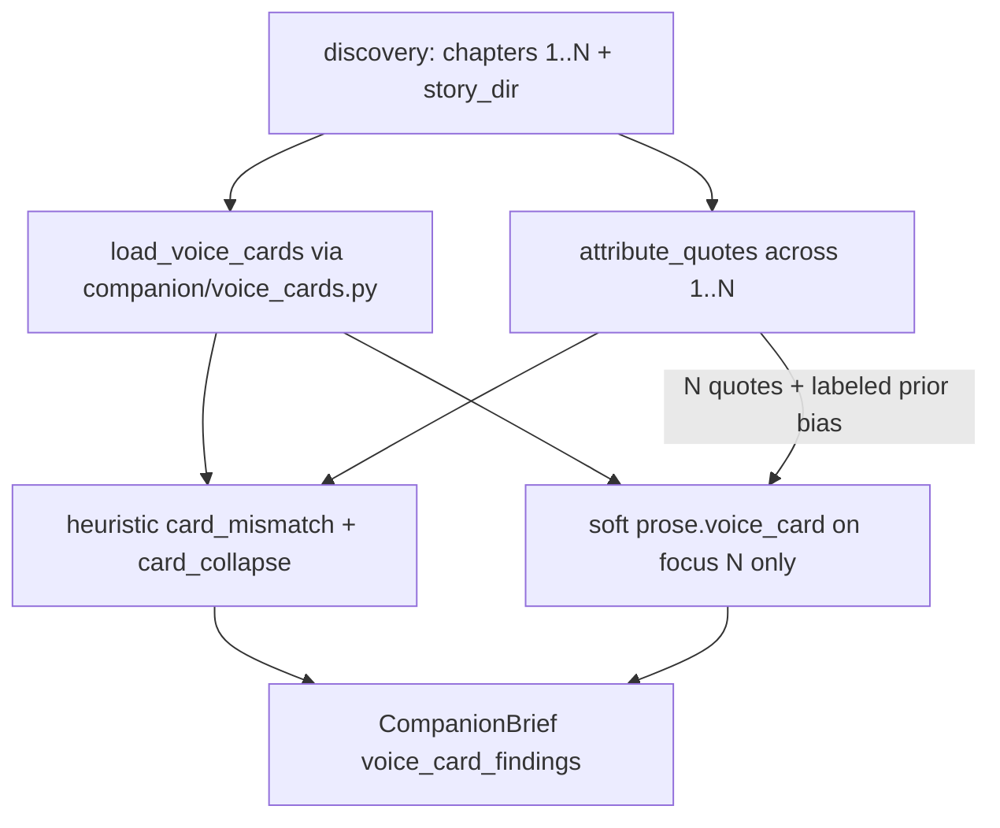

# Design: Companion voice-vs-card watch (GhostReader #11 / Autonomicon #264 / #263 KD-23 S7)

| Field | Value |
| --- | --- |
| **Author** | GhostReader craft design (Grok Build) |
| **Date** | 2026-10-25 |
| **Status** | Approved (review consensus, 0 open) |
| **Plan id** | `22f883cf` |
| **Issue** | [Shinran7/Ghostreader#11](https://github.com/Shinran7/Ghostreader/issues/11) — Companion voice-vs-card watch |
| **Parent seat** | Autonomicon [#264](https://github.com/deftai/Autonomicon/issues/264) / [#263](https://github.com/deftai/Autonomicon/issues/263) KD-23 S7 (outside Autonomicon product dual-stop) |
| **Repos** | GhostReader primary (`C:\Users\shinr\Projects\GhostReader`); Autonomicon soft consume (`C:\Users\shinr\Projects\Autonomicon`) |
| **Durable copy (intended)** | `GhostReader/docs/plans/design-22f883cf-11-voice-vs-card-watch.md` |
| **Autonomicon pointer (intended)** | `Autonomicon/docs/plans/design-22f883cf-11-voice-vs-card-watch.md` → points at Ghostreader#11 + durable GR path |
| **Parent SoT** | `Autonomicon/docs/plans/design-8dd80b5e-263-personality-speech-fidelity.md` (KD-23, S7) |
| **Checklist** | `Autonomicon/docs/plans/checklist-263-voice-fidelity-acceptance.md` S7 |
| **Pattern prior** | `GhostReader/docs/plans/design-d4440445-7-jargon-human-door-watch.md` (`register_findings` / #7) |
| **Delivery** | Direct-to-`master` YOLO slices. No `gh pr create`. "## PR Plan" = ordered master commits. |
| **Voice** | Zinsser for Overview / Key Decisions. Paths and function names stay concrete for implementers. |
| **Evidence** | Autonomicon character cards under `stories/<slug>/canon/characters/*.json` (`dialogue_voice`, `voice_wildcards`); Shatterbound / Resonance carded majors |

---

## Overview

Autonomicon #263 made speech fidelity enforceable upstream: forge voice cards, Writer speech packs, Editor collapse detect, quoted-line fidelity polish with TypeSafe. That closes the write path. It does not close the reader path.

KD-23 parked post-book literary follow-up on GhostReader companion: attributed dialogue vs canon `dialogue_voice` / `voice_wildcards`. Soft literary watch. No Autonomicon Review HOLD in v1. No eye-dialect (#237).

This design is that S7 seat only. Companion emits a per-speaker **voice-vs-card** signal when cards are discoverable beside the manuscript and enough attributed speech exists. Machine rows stay advisory (never flip ship alone). Soft craft dim `prose.voice_card` may mark `watch` the same way `prose.jargon_earn` does — and is the **primary literary reader** for card fidelity. Deterministic `card_collapse` plus a partial cue-based `card_mismatch` heuristic are the dual-stop-friendly machine cousins. Continuity stays king. Editor still owns inline collapse fix. GhostReader notices when the finished (or nearly finished) page still does not sound like the person on the card.

---

## Background & Motivation

### What landed upstream (#263 S1–S5)

| Surface | Path | Behavior |
| --- | --- | --- |
| Character schema | `Autonomicon/.../canon/schemas_character.py` | `dialogue_voice`, `voice_wildcards`, `voice_observations`, traits / attitude / want / need |
| On-disk cards | `stories/<slug>/canon/characters/{slug}.json` | Live cards are **JSON** (manager documents `characters/{slug}.json`); YAML may appear in seeds — GR must accept both |
| Editor collapse | `Autonomicon/.../agents/voice_fidelity.py` | `attribute_quotes` ±2 lines; surface metrics; pairwise card-contrast collapses; `AUTONOMICON_VOICE_FIDELITY` default on |
| Fidelity polish | Editor accept path + `polish_dialogue_fidelity` | Inline Ghostwriter + TypeSafe `voice_fidelity` judge |
| Review | chapter-level `dialogue_register` governor | **Not** per-speaker card fidelity (KD-23 / OQ-5) |

### What GhostReader has today

| Surface | Path | Behavior | Gap for #11 |
| --- | --- | --- | --- |
| Progressive companion | `ghostreader/companion/pipeline.py` | Facts → craft → continuity → brief; loads chapters **1…N** | No voice-vs-card watch |
| HOOK contract | `ghostreader/companion/HOOK.md` | **0.2.2**; `repetition_findings`, `register_findings` | Needs additive voice rows + version bump |
| Seed meta | `ghostreader/seed.py` `load_seed_meta` | Only `meta` from nearest `seed.yaml` | Does **not** load character cards |
| Discovery | `ghostreader/companion/discovery.py` | Resolves `story_dir`, `seed_meta` | `story_dir` is the right root for `canon/characters/` |
| Register pattern (#7) | `analyzers/register_detector.py`, `companion/register.py`, kill switch `companion_register_watch` | Heuristic rows + soft craft dims; machine rows never flip alone | Mirror for voice-vs-card |
| Continuity character | `consistency.character` gate dim | Personality flips / knowledge leaks; **can** flip `watch` + exit 2 | **Wrong home** for soft voice-vs-card (would hard-gate) |
| Autonomicon hook | `Autonomicon/.../integrations/ghostreader_companion.py` | Soft invoke `ghostreader companion … --format json`; ignores unknown keys | Ready for additive field |

### Why this watch exists

1. Editor fidelity is same-chapter and surface-metric first. Book-so-far literary “does Orin still sound like Orin’s card?” needs a reader.
2. Shatterbound evidence: sharp majors can match; carded pairs can still converge; thin cards leave nothing to check. Companion should fail-soft when cards are missing and still surface mismatches when cards are sharp.
3. KD-23 / OQ-5 locked owner = GhostReader companion, not Review HOLD.

### Related closed / sibling work (do not reopen)

| Issue | What it gave | What it did not give |
| --- | --- | --- |
| Autonomicon #263 S1–S5 | Forge cards, Writer packs, Editor collapse + fidelity polish | Post-book literary companion watch (S7) |
| Autonomicon #237 | Eye-dialect spelling allowlists (sibling) | Out of scope here |
| GhostReader #7 | `register_findings` + soft register dims; HOOK 0.2.2 | Voice-vs-card |
| GhostReader #10 / thrash | Analyze `thrash_findings` | Not companion voice |

---

## Goals & Non-Goals

### Goals

1. **Emit a per-speaker voice/personality-vs-card signal** on companion JSON after attributed speech is available (strongest on last chapter / finished book; useful mid-book when line counts clear a floor).
2. **Prefer existing craft/continuity surfaces** for soft judgment (new soft craft dim under craft band), **not** gate continuity dims.
3. **Discover Autonomicon canon cards** beside the manuscript (`story_dir/canon/characters/`) using `dialogue_voice` + `voice_wildcards`.
4. **Fail-soft** when cards are missing, unreadable, or speakers lack enough attributed lines → empty findings, optional warning.
5. **Kill switch** `companion_voice_card_watch` (default on), mirroring `companion_register_watch`.
6. **Dual-stop fixtures without live LLM** for discovery, attribution, heuristic mismatch, brief schema, kill switch, and verdict wiring.
7. **Additive HOOK contract** with an explicit version bump to **0.2.3**.

### Non-Goals

- Autonomicon Review HOLD for per-speaker voice in v1.
- Eye-dialect spelling allowlists (#237).
- Replacing Editor collapse detect / fidelity polish (#263 S4–S5).
- Putting voice-vs-card on `consistency.character` (gate / exit-2 path).
- Making machine `voice_card_findings` alone flip `watch` or exit 2.
- Full behavioral personality simulation.
- Cross-repo Python imports from Autonomicon (copy the attribution pattern; comment to keep in sync).
- Autonomicon Writer promote / avoid-ledger wiring in GhostReader dual-stop (optional Autonomicon soft-consume slice after GR lands).
- Forcing analyze to become the primary owner (analyze may get a secondary export; companion is primary).

---

## Proposed Design

### 1. When it fires (locked — primary path)

**Primary path: progressive companion on chapter N, attributing dialogue across loaded chapters 1…N.**

| Surface | When | Job |
| --- | --- | --- |
| **Progressive companion (primary)** | Each `ghostreader companion chapter-NNN.md` when craft is on and `companion_voice_card_watch` is true | Attribute quotes across discovery’s loaded **1…N** chapters; compare carded speakers to cards; emit `voice_card_findings` (+ optional soft craft dim). Strongest when N = last chapter on disk (“finished book”). Mid-book still emits when a speaker clears `min_lines`. |
| **Sweep companion** | Directory / sweep invoke | Same detector over the loaded set; focus chapter labels rows. |
| **Analyze (secondary, optional v1)** | `ghostreader analyze` at **standard/deep** when `analyze_voice_card_watch` is on | EoB cleanup skill sees the same machine rows book-wide. Soft `prose.voice_card` stays **companion-only** in v1 (stock analyze prose five-pack unchanged). |

**Why this primary path (not analyze-only EoB):**

1. KD-23 / issues name **companion** as owner; Autonomicon’s live hook is `ghostreader companion`, not analyze.
2. Companion already loads **1…N** (`discovery._load_up_to`). Book-so-far attribution is free of a new ingest mode.
3. “After a finished book” = companion on the last chapter (or sweep). Same code path covers mid-book progressive soft watch without a second product.
4. Pure analyze-only would miss the progressive Autonomicon gate Autonomicon already runs after ACCEPT.
5. Pure N-only attribution (ignore priors) is too thin for per-speaker floors; 1…N matches the literary “person across the book” ask.



**Scope lock (machine vs soft):**

| Layer | Attribution / evidence scope | Judges |
| --- | --- | --- |
| Machine `voice_card_findings` | Quotes attributed across loaded **1…N** | Cue mismatch + pairwise collapse on book-so-far metrics |
| Soft `prose.voice_card` | Manuscript excerpt = **focus chapter N only** (same as `run_companion_craft` / register). Bias block may cite prior-chapter heuristic rows **labeled as prior context only** | Literary card fidelity for speech visible in N; must not invent concerns for chapters absent from the excerpt |

**Kill switches:**

| Knob | Default | Role |
| --- | --- | --- |
| `companion_voice_card_watch` | `true` | Master kill for companion heuristic + soft voice-card dim |
| `analyze_voice_card_watch` | `true` | Master kill for analyze heuristic export (secondary) |

When off: `voice_card_findings` still present as `[]`; companion asks no `prose.voice_card` dim.

### 2. Card discovery (fail-soft)

**Locked IO home:** `ghostreader/companion/voice_cards.py` owns discovery + parse. Keep `ghostreader/seed.py` meta-only. Detector / analyze export **import** from this module (do not re-home `load_voice_cards` under `analyzers/`).

```python
# ghostreader/companion/voice_cards.py
def find_canon_characters_dir(story_dir: Path) -> Path | None:
    """Return story_dir/canon/characters if it is a directory; else None."""

def load_voice_cards(story_dir: Path) -> list[VoiceCard]:
    """Load *.json / *.yaml / *.yml under canon/characters. Fail-soft → []."""
```

**`VoiceCard` fields (v1):** `slug`, `name`, `dialogue_voice`, `voice_wildcards: list[str]`, `weight: str | None`. Ignore unknown keys. Skip files that fail parse (collect warning). Skip cards with empty stripped `dialogue_voice` (uncarded for contrast — same spirit as Autonomicon `cards_eligible_for_contrast`).

**Discovery root:** `DiscoveryResult.story_dir` from `discovery.py` (already skips generic `chapters/` parents) → `story_dir/canon/characters`. If that miss, fail-soft try `find_seed_yaml(path).parent / "canon" / "characters"` (first hit wins). **Note:** for normal Autonomicon trees (`stories/<slug>/chapters/…` + `seed.yaml` at story root) the seed-parent path is **usually identical** to `story_dir`; the fallback exists only for odd seed placement.

**No cards:** emit `voice_card_findings=[]`; append warning `"voice_card watch: no canon/characters cards found"` only when the kill switch is on (avoid noise when off). Do **not** fail the companion run.

### 3. Attribution (no new NLP stack)

Port Autonomicon’s `voice_fidelity.attribute_quotes` cousin into GhostReader (do **not** import across repos). Do **not** blindly copy the first-token alias bug for titled names (Issue 2 / KD-7).

```text
# Cousin of Autonomicon agents/voice_fidelity.attribute_quotes — keep ±2 line
# same-line-first behavior in sync. Ghostreader#11 / Autonomicon#264.
# DELIBERATE DIVERGENCE: skip title tokens (Dr./Doctor/Captain/…) when building
# the given-name alias so "Dr. Selah Abe" aliases to "selah", not "dr.".
```

#### 3.1 Attribution contract (locked)

| Rule | Lock |
| --- | --- |
| Cast | `[(card.slug, card.name), …]` from loaded voice cards only |
| Name match order | (1) full `name.casefold()` substring; (2) safe given-name alias (first non-title Proper token after skipping `Dr.` / `Doctor` / `Mr.` / `Mrs.` / `Ms.` / `Miss` / `Captain` / `Capt.` / `Sir` / `Dame` / `Prof.` / `Professor`); longest name first |
| Form A / B (v1 sense) | **Name-in-window** via the `attribute_quotes` cousin: cast name/tag on the **same line** as the quote, else in the **±2 line** window — same surface as Autonomicon Editor fidelity attribution. **Not** Autonomicon dialogue_domain / `dialogue_rewrite_spans` Form A/B house grammar or said-verb regex stacks |
| Form C (v1 sense) | Bare quotes with **no** cast name in that window are **unattributed** — no row credit in v1 (accepted limit, not an oversight). Alternating Form C is the adjacent-theft risk; fixtures must cover tagged name-in-window turns |
| Join key | `speaker`, `speaker_b`, and `normalized_key` use the **card slug** (e.g. `orin-drevane`, `dr-selah-abe`), never a shortened nickname. Collapse `normalized_key` = `card_collapse:` + **sorted** `slug_a\|slug_b` (matches Autonomicon pairwise / prior-alert pair sorting) |
| Body prep | `strip_chapter_body` before scanning |
| Aggregate | `slug → list[quote]` across loaded **1…N**; track `chapters_spoken` |
| Floor | `min_lines` default **4** (match Autonomicon `find_voice_collapses`); below floor → no row |

Richer Autonomicon near-attr also lives in `dialogue_domain.quoted_turns_by_near_attribution`; v1 does **not** port that path (see Alternatives A6).

### 4. Additive brief field + contract bump

Bump companion `GHOSTREADER_VERSION` in `ghostreader/companion/brief.py` from **`0.2.2` → `0.2.3`**.

Update `HOOK.md` with a “Since 0.2.3” section. Document **JSON-primary** (markdown/terminal need not render machine rows in v1), same as `register_findings`.

#### 4.1 Machine rows: `voice_card_findings`

Always present on companion JSON (empty list OK). Cap **15**.

| Field | Type | Notes |
| --- | --- | --- |
| `kind` | `card_mismatch` \| `card_collapse` | Detector bucket |
| `severity` | `high` \| `moderate` \| `low` | Machine bands |
| `summary` | string | One-line human summary |
| `speaker` | string | Primary **card slug** (collapse: slug_a), e.g. `orin-drevane` |
| `speaker_b` | string \| null | Collapse partner **card slug**; null on mismatch |
| `quote` | string \| null | One verbatim attributed span (prefer from latest chapter spoken) |
| `card_excerpt` | string \| null | Truncated `dialogue_voice` (≤120 chars) |
| `metrics` | object \| null | Always include `{line_count, avg_words, contraction_rate, fragment_rate, interruption_rate}` when metrics are attached (null only when omitted entirely) |
| `chapters` | int[] | Chapters where this speaker’s quotes were found |
| `chapter` | int | Focus chapter N (brief chapter_number) |
| `normalized_key` | string \| null | e.g. `card_mismatch:fixture-terse-warden` or `card_collapse:garen-solwick|ysolde-kestrel` (**full card slugs**; collapse pair **sorted** `a\|b`) |

**Kinds (locked) — product priority reframed:**

| Kind | Meaning | v1 detector | Product role |
| --- | --- | --- | --- |
| `card_mismatch` | Attributed speech conflicts with that speaker’s card cue families | Deterministic cue heuristic (§5.2) | **Partial** dual-stop machine signal — not full live-card recall |
| `card_collapse` | Two **differently carded** speakers look surface-similar | Port Autonomicon pairwise deltas (`find_voice_collapses`) | Machine cousin of Editor; fixture-reliable |

**v1 primary reader value** = soft `prose.voice_card` **plus** machine `card_collapse`. Cue-based `card_mismatch` remains shipped and useful when cards hit the lexicon, but synthetic cue fixtures ≠ live Shatterbound/Resonance recall. Orin-class cards (“Measured sermon cadence… No jokes…”) often miss the old terse/formal substring set; soft dim carries the literary KD-23 ask for those.

#### 4.2 Soft craft dim (companion-only)

```python
COMPANION_VOICE_CARD_DIMENSIONS: tuple[str, ...] = (
    "prose.voice_card",
)

# Instruction gist (THIS CHAPTER = focus N, mirror register wording):
# Rate whether attributed dialogue for carded speakers in THIS CHAPTER matches
# each speaker's dialogue_voice / voice_wildcards. Concern = clear mismatch
# or carded speakers collapsing into one register despite distinct cards,
# using quotes visible in the chapter excerpt. Heuristic rows labeled
# "prior" are context only — do not invent concerns for chapters not in
# the excerpt. Strength = distinct, card-faithful speech. Do not invent
# eye-dialect spelling issues (#237). Fail soft when cards missing.
```

Land under existing `craft_findings` / `craft_ratings`. Enrich must supply a quote for concerns. **Do not** project LLM concerns into `voice_card_findings` in v1 (same split as #7).

Bias block for craft (mirror `register_block`); **label prior-chapter rows**:

```text
## Voice-vs-card heuristic
Algorithmically-detected voice/card signals (book-so-far machine rows):
  - [card_collapse/moderate] speaker=garen-solwick speaker_b=ysolde-kestrel chapters=[3,7,12] (prior+focus)
  - [card_mismatch/moderate] speaker=fixture-terse-warden chapters=[3,7] (prior — context only)
Focus-chapter N quotes are in the manuscript excerpt; do not re-litigate prior-only evidence as a new N concern without N text.
```

### 5. Deterministic heuristic (dual-stop core)

Module split (mirror register; **IO separate from detector**):

| Module | Role |
| --- | --- |
| `ghostreader/companion/voice_cards.py` | Card IO: `find_canon_characters_dir`, `load_voice_cards`, `VoiceCard` |
| `ghostreader/analyzers/voice_card_detector.py` | Attribution + surface metrics + mismatch/collapse emit (imports cards IO) |
| `ghostreader/companion/voice_card.py` | Cap, dict rows, `voice_card_block` bias string |
| `ghostreader/companion/voice_card_constants.py` | `VOICE_CARD_FINDINGS_CAP=15`, `VOICE_CARD_MIN_LINES=4`, cue lexicons, title-skip set |
| `ghostreader/report/voice_card_export.py` | Analyze-side aggregation (secondary) |

#### 5.1 Surface metrics

Port `speaker_surface_metrics` from Autonomicon `voice_fidelity.py` — always compute `line_count`, `avg_words`, `contraction_rate`, `fragment_rate`, **`interruption_rate`**.

**Collapse gate = pairwise absolute deltas** (implementers: copy `find_voice_collapses` lines 159–163; do **not** treat the numbers as absolute metric ceilings):

- both speakers `line_count >= min_lines` (default 4)
- `cards_eligible_for_contrast` (both cards non-empty stripped and unequal)
- `|Δavg_words| ≤ 2.0`
- `|Δcontraction_rate| ≤ 0.10`
- `|Δfragment_rate| ≤ 0.10`

`interruption_rate` is **emitted in row `metrics`** and may feed mismatch cue families; it is **not** part of the Autonomicon collapse gate today.

#### 5.2 Card-mismatch cue heuristic (no LLM)

Cheap, imperfect, fixture-friendly **partial** signal. Parse card text + wildcards for register cues; compare to speaker metrics. Expand families with live-card vocabulary (Shatterbound / Resonance), knowing recall is still incomplete:

| Card cue family (casefold substrings / stems) | Expectation | Fire when | Live-card notes |
| --- | --- | --- | --- |
| terse / clipped / short / laconic / curt | low `avg_words` | `avg_words >= 12` and `line_count >= min_lines` | Common forge compact voices; also absorbs **monotone / radio** when those stems appear **without** a long-register neighbor (see split below) |
| formal / precise / clinical / articulate / complex / syntactically | low contraction | `contraction_rate >= 0.35` | Resonance Selah-class |
| colloquial / slang / casual / contractions | high contraction | `contraction_rate <= 0.05` and `line_count >= min_lines` | |
| fragmentary / interrupted / trailing | high fragment or interruption | both rates near 0 despite card claim | |
| sermon / cadence / liturgy / oratorical | mid/high `avg_words` **or** very low contraction | `avg_words <= 4` **or** `contraction_rate >= 0.40`, with `line_count >= min_lines` | Orin-class long/sermon register. Match these stems (or multi-token `sermon cadence`). **Do not** key bare `measured` / bare `protocol` alone |
| monotone / radio | low `avg_words` (clipped/flat) | same fire as terse family (`avg_words >= 12` …) | Short/flat protocol voice. Prefer this family when `monotone`/`radio` present **without** sermon/liturgy/oratorical neighbors |
| deadpan / dry / biting / sarcasm | — | soft-dim primary; heuristic may no-op | Often no metric proxy |
| dialect / endearment / oath | — | soft-dim primary; **no** eye-dialect spelling checks | #237 out of scope |

**Polarity rules (locked — Issue round-2):**

1. **Split long vs short.** `sermon / cadence / liturgy / oratorical` ≠ `monotone / radio`. Never merge them into one fire rule.
2. **Ambiguous stems.** Bare `measured` and bare `protocol` are **soft-dim-primary** (no heuristic fire) unless a disambiguating neighbor is present in the card text (e.g. `sermon cadence`, `radio protocol` → treat under the matching family above). Cards that say only “short, measured sentences” stay on the terse family via `short`, not via `measured`.
3. **S1 fixtures.** Ship at least **one fixture per polarity**: (a) long/sermon card + short attributed speech → `card_mismatch`; (b) radio/monotone or terse card + long attributed speech → `card_mismatch`. Merged-rule implementations must fail these.

Severity: one cue miss → `moderate`; two+ cue families → `high`. Always attach one quote + `card_excerpt`.

Wildcards: if any wildcard situation keyword appears near a quote context (±1 line) and the quote still violates the wildcard’s implied change, prefer that quote in evidence (best-effort; miss is OK).

**Acceptance note:** synthetic cue fixtures prove wiring and polarity split; they are **not** a claim of high live-card recall. Dual-stop green on fixtures ≠ Shatterbound/Resonance hit-rate proof. Soft `prose.voice_card` + `card_collapse` carry the literary product ask when cue lexicon misses.

**Not in v1:** embedding similarity, eye-dialect token checks, full LLM-in-heuristic, Autonomicon `quoted_turns_by_near_attribution` port.

### 6. Severity → verdict (locked)

| Band | Flips `verdict` to `watch`? | Exit `2` (`--fail-on-continuity`)? |
| --- | --- | --- |
| Gate continuity | Yes | Yes |
| Soft craft (incl. `prose.voice_card`) | **Yes** (existing craft rule) | No |
| Machine `voice_card_findings` alone | **No** | No |
| Info continuity | Never alone | No |

`verdict_drivers`: soft voice-card concerns stay under **`"craft"`**. No `"voice_card"` driver in v1.

`--continuity-only` → skip watch entirely (`[]`, no soft dim). Kill switch off → same.

### 7. Pipeline wiring

In `run_companion_pipeline` (beside register watch):

1. After craft window / register heuristic (or parallel-safe before `run_companion_craft`):
2. If `companion_voice_card_watch` and not `continuity_only`:
   - `cards = load_voice_cards(discovery.story_dir)`  # from `companion.voice_cards`
   - `voice_card_findings = voice_card_findings_for_chapters(discovery.chapters, cards, focus_n=…)`  # machine = 1…N
   - Build `voice_card_block(...)` into craft context when soft dim is on (**label prior-chapter rows**; soft dim still sees focus-N excerpt only)
3. Else: `voice_card_findings = []`
4. Pass findings into `CompanionBrief` / `brief_to_payload`

Config: add fields on `GhostreaderConfig` + `config.yaml` + companion CLI pass-through (`ghostreader/commands/companion.py`).

### 8. Autonomicon soft consume (out of GR product dual-stop; optional trailing slice)

Mirror #7 S4 posture:

1. Document that Autonomicon ignores unknown keys today; missing `voice_card_findings` ≡ `[]`.
2. Optional fail-soft `_voice_card_signal_counts(brief)` in `ghostreader_companion.py` — counts high/moderate machine rows + soft `prose.voice_card` concerns. **No** promote. **No** new hard-gate flag. **No** Review HOLD.

Not required to close GhostReader #11 dual-stop.

---

## API / Interface Changes

### Companion JSON (0.2.3)

```json
{
  "ghostreader_version": "0.2.3",
  "register_findings": [],
  "voice_card_findings": [
    {
      "kind": "card_mismatch",
      "severity": "moderate",
      "summary": "fixture-terse-warden attributed speech runs long vs card cue 'terse, clipped oaths'.",
      "speaker": "fixture-terse-warden",
      "speaker_b": null,
      "quote": "I would prefer that we reconsider the entire arrangement before dawn.",
      "card_excerpt": "Terse, clipped oaths; few contractions; short clauses.",
      "metrics": {
        "line_count": 9,
        "avg_words": 14.2,
        "contraction_rate": 0.0,
        "fragment_rate": 0.11,
        "interruption_rate": 0.0
      },
      "chapters": [3, 7, 12, 18],
      "chapter": 18,
      "normalized_key": "card_mismatch:fixture-terse-warden"
    }
  ],
  "craft_findings": [],
  "verdict_drivers": []
}
```

### Config

```yaml
companion_voice_card_watch: true
analyze_voice_card_watch: true
```

### HOOK.md verdict table addition

| Band | Flips `watch`? | Exit 2? |
| --- | --- | --- |
| Machine `voice_card_findings` alone | **No** | No |
| Soft `prose.voice_card` (craft) | Yes | No |

---

## Data Model Changes

| Artifact | Change |
| --- | --- |
| `CompanionBrief` | Add `voice_card_findings: list[dict] = field(default_factory=list)` |
| `GHOSTREADER_VERSION` | `0.2.2` → `0.2.3` |
| `brief_to_payload` | Always emit `voice_card_findings` |
| `ReportOutput` (analyze secondary) | Additive `voice_card_findings` (empty OK); document in `ANALYZE_HOOK.md` **without** requiring analyze contract bump unless export tests prefer it |
| On-disk GhostReader state | **No** new fact-store schema in v1 (re-attribute each run from chapter text; cards read live from canon) |
| Autonomicon canon | Read-only; no writes |

**Migration:** none. Additive JSON. Old Autonomicon parsers ignore the new key.

---

## Alternatives Considered

### A1. End-of-book `ghostreader analyze` only

- **Pros:** One deep pass; natural “finished book”; thrash/register already have analyze exports.
- **Cons:** Breaks KD-23 companion ownership; Autonomicon progressive hook would never see the signal; mid-book drift invisible.
- **Decision:** Reject as primary. Keep analyze as **secondary** export only.

### A2. Soft-only via `consistency.character` (no new field)

- **Pros:** Zero HOOK bump; reuses gate dim language about personality.
- **Cons:** Gate dim can flip exit 2 under `--fail-on-continuity`; mixes fact-sheet continuity with literary voice; hard to dual-stop without LLM; violates soft-watch lock.
- **Decision:** Reject. New machine field + optional craft soft dim.

### A3. Progressive N-only attribution (ignore chapters &lt; N)

- **Pros:** Cheaper; mirrors register’s opening-window locality.
- **Cons:** Per-speaker `min_lines` rarely clears mid-book; “person across the book” needs 1…N; companion already loaded priors.
- **Decision:** Reject for **machine** rows. Attribute across loaded 1…N. Soft dim stays **focus-N** (excerpt reality); prior heuristic rows are labeled context only (§1 scope lock).

### A4. Machine rows only (no soft `prose.voice_card`)

- **Pros:** Smaller TypeSafe surface; cheaper; pure dual-stop.
- **Cons:** Cue heuristic undercovers live Orin-class / metaphor-rich cards; literary KD-23 ask would hollow out.
- **Decision:** Ship heuristic in S1–S2; soft dim in S3 (kill-switchable). Soft dim + collapse are the primary reader value; cue mismatch is partial.

### A5. Import Autonomicon `voice_fidelity` directly

- **Pros:** Single implementation of attribution/metrics.
- **Cons:** Cross-repo runtime coupling; Autonomicon not a GhostReader dependency; CI/layout pain.
- **Decision:** Reject. Port + sync comment (same as register constants cousin rule), with deliberate titled-name alias fix (KD-7).

### A6. Port Autonomicon `quoted_turns_by_near_attribution` instead of `attribute_quotes` cousin

- **Pros:** Richer near-attr; may credit more name-tagged turns Editor already sees.
- **Cons:** Heavier dependency surface; still leaves bare quotes unattributed; risks pulling dialogue_domain Form A/B house grammar / said-verb stacks that v1 explicitly is not; Editor path is write-time, not GR literary brief.
- **Decision:** **Defer.** v1 locks the lighter `attribute_quotes` cousin (name-in-window only) + bare-quote = no credit (accepted). Revisit only if Autonomicon operators show systematic under-attribution on tagged dialogue.

---

## Security & Privacy Considerations

| Threat | Severity | Mitigation |
| --- | --- | --- |
| Path traversal via crafted chapter paths into unexpected `canon/` | Low | Only read `story_dir/canon/characters` and seed-parent variant; no user-supplied card path flag in v1 |
| Card YAML/JSON bombs | Low | `yaml.safe_load` / bounded JSON; skip on error; no execute |
| Leaking full card text into logs | Low | Brief stores truncated `card_excerpt` (≤120); stderr counts only |
| Prompt injection via hostile dialogue into soft dim | Low–Med | Soft dim is advisory craft only; never exit 2; kill switch |

No new network calls beyond existing TypeSafe/LLM craft path.

---

## Observability

| Signal | Where |
| --- | --- |
| `Voice-card watch: kept K row(s)` | companion stderr (JSON mode quiet on stdout) |
| `Voice-card watch: off (kill switch)` | stderr |
| `voice_card watch: no canon/characters cards found` | `warnings[]` when watch on and cards missing |
| Finding counts by kind/severity | optional debug; dual-stop asserts in tests |

No new metrics backend. Autonomicon ledger optional later (out of GR dual-stop).

---

## Rollout Plan

1. **S0** land durable design on GhostReader `docs/plans/`.
2. **S1–S4a** YOLO master slices with fixture dual-stop (no live LLM); **S4b** analyze export may defer.
3. Default knobs **on**; operators kill with `companion_voice_card_watch: false`.
4. Autonomicon soft-consume docs/helper **after** GR brief is green (optional).
5. **Rollback:** set kill switch false → `[]` + stock craft dims (no `prose.voice_card`); contract field remains present empty (forward-compatible). Version stays 0.2.3 once bumped (do not bounce versions).

---

## Risks

| Risk | Severity | Mitigation |
| --- | --- | --- |
| Attribution steals adjacent-speaker lines (esp. Form C) | Med | Same-line-first then ±2; Form C unattributed by contract; fixtures with alternating **tagged** Form A/B |
| Titled-name alias (`Dr.` → false match) | Med | Skip title tokens when building given-name alias; titled-name fixture (Selah-class) |
| Soft dim flags N for prior-only drift | Med | Scope lock: soft = focus N; bias labels prior rows as context only |
| Cue lexicon undercovers live cards | Med | Reframe: soft + collapse primary; expand cue families; acceptance note synthetic ≠ live recall |
| False mismatch on intentional register shift (wildcard situations) | Med | Soft dim instructions name wildcards; heuristic is cue-family not full NLP; severity capped; kill switch |
| Duplicate Editor collapse noise | Low | Machine collapse is advisory; soft dim is literary; Autonomicon may ignore machine rows |
| Cost: soft dim + long quote packs on late chapters | Med | Cap speakers sent to soft bias (top 8 by line_count); quote samples ≤3 per speaker; kill switch |
| Cards are JSON but issue text said YAML | Low | Accept `.json` / `.yaml` / `.yml` |
| Mid-book spam before enough lines | Low | `min_lines=4` book-so-far floor |

---

## Open Questions

| ID | Question | Default if unanswered |
| --- | --- | --- |
| OQ-1 | Ship soft `prose.voice_card` in the same dual-stop wave as heuristic, or heuristic-only first? | **Same wave** (S3 after S1–S2), kill-switchable — matches #7 |
| OQ-2 | Analyze secondary export in v1 dual-stop or defer? | **Prefer S4b**; GR #11 dual-stop is green after **S4a** (companion pipeline+config) if analyze export is deferred |
| OQ-3 | Autonomicon `_voice_card_signal_counts` in this plan? | **Optional trailing Autonomicon slice**; not required to close GR #11 |
| OQ-4 | Cap soft-dim speaker pack at 8? | **Yes** (constant in `voice_card_constants.py`) |

---

## References

- GhostReader #11; Autonomicon #264; Autonomicon #263 KD-23 S7
- Parent design: `Autonomicon/docs/plans/design-8dd80b5e-263-personality-speech-fidelity.md`
- Checklist: `Autonomicon/docs/plans/checklist-263-voice-fidelity-acceptance.md` S7
- Pattern prior: `GhostReader/docs/plans/design-d4440445-7-jargon-human-door-watch.md`
- Code anchors: `ghostreader/companion/{pipeline,brief,discovery,register,HOOK}.md|py`, `ghostreader/seed.py`, `ghostreader/analyzers/register_detector.py` (`strip_chapter_body`), `Autonomicon/src/autonomicon/agents/voice_fidelity.py`, `Autonomicon/src/autonomicon/canon/schemas_character.py`, `Autonomicon/src/autonomicon/integrations/ghostreader_companion.py`, `stories/*/canon/characters/*.json`

---

## Key Decisions

1. **KD-1 — Primary path = progressive companion with 1…N attribution.** “Finished book” = companion on last chapter / sweep. Analyze is secondary export only. *Rationale:* KD-23 companion ownership; discovery already loads 1…N; Autonomicon hook is companion.

2. **KD-2 — Soft literary watch, not gate continuity.** New `voice_card_findings` + optional `prose.voice_card` under craft. Never `consistency.character`. Machine rows alone never flip `watch` / exit 2. *Rationale:* Operator soft/non-blocking; avoid `--fail-on-continuity` landmines.

3. **KD-3 — Fail-soft when cards missing.** Empty `[]` + optional warning; run continues. *Rationale:* Parent lock; non-Autonomicon manuscripts must not break.

4. **KD-4 — HOOK bump 0.2.2 → 0.2.3** for additive `voice_card_findings` (JSON-primary). Soft-only dims do **not** bump (HOOK / `prose.earth_anachronism` stayed on **0.2.2** with no new `register_findings` kind). New always-present machine arrays **do** bump (#7 `register_findings` / this field). *Rationale:* Keep contract bumps meaningful; prevent “skip bump” optimization.

5. **KD-5 — Kill switch `companion_voice_card_watch` default on.** *Rationale:* Operator preference for new watches; mirror `companion_register_watch`.

6. **KD-6 — Kinds = `card_mismatch` \| `card_collapse`; primary reader value = soft dim + collapse.** Cue `card_mismatch` is a partial dual-stop machine signal. Cue families split long-register (`sermon`/`cadence`/`liturgy`/`oratorical`) from short-flat (`monotone`/`radio` → terse fire); bare `measured`/`protocol` are soft-dim-primary unless a disambiguating neighbor appears. *Rationale:* Avoid polarity false positives; synthetic fixtures ≠ Shatterbound recall.

7. **KD-7 — Port attribution cousin; do not import Autonomicon; fix titled-name alias.** Cast = card slug+name; v1 “Form A/B” = **name-in-window** (same-line then ±2), not dialogue_domain house grammar; Form C unattributed; `speaker`/`normalized_key` = **card slug** (collapse pair **sorted**); skip title tokens when building given-name alias (`Dr. Selah Abe` → `selah`, not `dr.`). Sync comment notes the deliberate divergence. `min_lines=4`; reuse `strip_chapter_body`. *Rationale:* Repo boundary; avoid copying known Autonomicon first-token bug; Form C limit is explicit.

8. **KD-8 — No eye-dialect (#237); no Review HOLD.** *Rationale:* Parent non-goals.

9. **KD-9 — Prefer craft surface over inventing a new verdict driver.** Soft concerns → `"craft"` in `verdict_drivers`. Soft dim judges **focus N**; machine rows aggregate **1…N**. *Rationale:* #7 / HOOK stability; match `run_companion_craft` excerpt reality.

10. **KD-10 — Dual-stop = fixtures only (no live LLM).** Heuristic + schema + kill switch + verdict wiring. Soft dim tested with stubbed TypeSafe/LLM paths. GR #11 product dual-stop green after **S4a** if analyze export (S4b) defers. *Rationale:* Issue acceptance; YOLO 90-minute safety.

11. **KD-11 — Card IO lives in `companion/voice_cards.py`.** Detector imports it; `seed.py` stays meta-only. *Rationale:* Clear import boundary for companion vs analyze export.

12. **KD-12 — Collapse thresholds are pairwise deltas.** `|Δavg_words|≤2.0`, `|Δcontraction_rate|≤0.10`, `|Δfragment_rate|≤0.10` plus eligibility + `min_lines`. `interruption_rate` is always in row metrics when present, not in the collapse gate. *Rationale:* Match Autonomicon `find_voice_collapses`; avoid absolute-ceiling misread.

---

## PR Plan

Ordered YOLO implementation slices. Each lands on GhostReader `master` (no GitHub PR). Independently shippable; later slices no-op safely if earlier ones are present.

### S0 — Land design SoT
- **Title:** `docs(plans): #11 voice-vs-card companion watch design 22f883cf`
- **Files:** `docs/plans/design-22f883cf-11-voice-vs-card-watch.md` (copy from this scratch doc); optional Autonomicon pointer stub under `Autonomicon/docs/plans/`
- **Dependencies:** None
- **Changes:** Durable design only. No runtime change.
- **Dual-stop:** File exists; links #11 / #264 / KD-23.

### S1 — Card load + attribution + heuristic detector
- **Title:** `feat(companion): #11 voice-card detector (load + attribute + mismatch/collapse)`
- **Files:** `ghostreader/companion/voice_cards.py` (`load_voice_cards`, `VoiceCard`); `ghostreader/companion/voice_card_constants.py` (caps, cue lexicon, title-skip set); `ghostreader/analyzers/voice_card_detector.py` (`attribute_quotes`, `speaker_surface_metrics`, `detect_voice_card_issues` — imports cards IO); `tests/test_voice_card_detector.py`; fixtures under `tests/fixtures/voice_card/` (mini chapters + `canon/characters/*.json` including a **titled name** card)
- **Dependencies:** S0
- **Changes:** Fail-soft card discovery (json/yaml) in `voice_cards.py`; 1…N attribution with name-in-window contract + titled-name alias fix; `card_mismatch` cue heuristic with **split long/short polarity** (no bare `measured`/`protocol` alone); `card_collapse` **pairwise deltas** + sorted slug `normalized_key`; `min_lines=4`; slug keys; no pipeline wire yet.
- **Dual-stop:** Fixtures prove mismatch + collapse + empty-cards `[]` + frontmatter strip + titled-name alias (`Dr. Selah Abe` → Selah) + **one fixture per cue polarity** (sermon-long vs radio/terse-short); no live LLM.

### S2 — Brief schema 0.2.3 + HOOK.md
- **Title:** `feat(companion): #11 voice_card_findings on brief contract 0.2.3`
- **Files:** `ghostreader/companion/brief.py` (`CompanionBrief`, `brief_to_payload`, `GHOSTREADER_VERSION`); `ghostreader/companion/voice_card.py` (projection/cap/`voice_card_block`); `ghostreader/companion/HOOK.md` (Since 0.2.3; verdict table; kinds); `tests/test_companion_brief.py`
- **Dependencies:** S1 (projection can take dicts; detector import optional)
- **Changes:** Always emit `voice_card_findings` (default `[]`); version **0.2.3**; JSON-primary docs.
- **Dual-stop:** Payload always includes key; kinds only `card_mismatch` \| `card_collapse`; existing verdict tests green.

### S3 — Soft `prose.voice_card` + kill switch bank
- **Title:** `feat(typesafe): #11 prose.voice_card companion questions`
- **Files:** `ghostreader/typesafe/questions.py` (`COMPANION_VOICE_CARD_DIMENSIONS` + instructions); `ghostreader/companion/craft.py` (merge dim when enabled; bias block hook); craft/TypeSafe path tests with stubs
- **Dependencies:** S2
- **Changes:** Soft dim companion-only; do not alter stock analyze five-pack; instructions forbid eye-dialect scope-creep.
- **Dual-stop:** Stubbed questions include `prose.voice_card` when watch on; stock five only when off.

### S4a — Companion pipeline + config wire
- **Title:** `feat(companion): #11 wire voice-card watch into companion pipeline`
- **Files:** `ghostreader/companion/pipeline.py`; `ghostreader/config.py`; `config.yaml` (`companion_voice_card_watch`); `ghostreader/commands/companion.py`; `tests/test_companion_voice_card_pipeline.py`
- **Dependencies:** S1–S3
- **Changes:** Companion wire; machine 1…N + soft focus-N bias labeling; `--continuity-only` / kill switch → `[]` + no soft dim; missing cards warning.
- **Dual-stop:** End-to-end companion fixture with stubbed craft; kill switch; missing cards warning. **GR #11 product dual-stop is green after S4a** even if S4b defers.

### S4b — Analyze secondary export (may defer)
- **Title:** `feat(analyze): #11 voice_card_findings analyze export`
- **Files:** `ghostreader/report/voice_card_export.py`; `ghostreader/report/__init__.py`; `ghostreader/report/json_export.py`; `ghostreader/cli.py` (depth gate standard/deep); `config.yaml` / `config.py` (`analyze_voice_card_watch`); `ghostreader/report/ANALYZE_HOOK.md`; analyze export tests
- **Dependencies:** S1 (row shape); S4a recommended
- **Changes:** Analyze standard/deep emits machine rows; quick / kill-off → `[]`; soft dim stays companion-only.
- **Dual-stop:** Export empty-OK; depth gate. Deferrable under OQ-2 without blocking GR #11 close.

### S5 — Autonomicon soft-consume docs (optional trailing)
- **Title:** `docs(integrations): #264 / Ghostreader#11 soft consume voice_card_findings`
- **Files (Autonomicon):** `docs/ghostreader-companion.md` and/or `integrations/ghostreader_companion.py` fail-soft `_voice_card_signal_counts`; checklist S7 mark; pointer design doc
- **Dependencies:** S4a on GhostReader master
- **Changes:** Fail-soft counts only; **no** promote; **no** Review HOLD; **no** hard-gate flag.
- **Dual-stop:** Missing key does not throw; helper unit-tested. Not required to close GR #11 if operator defers.

### Suggested land order

`S0 → S1 → S2 → S3 → S4a` (→ optional `S4b`), then optional `S5` on Autonomicon. S2 can start once S1 row shape is stable. Do not claim S4a green without S1 fixtures.

### Dual-stop (GhostReader product)

- **Success:** S0–S4a on master; fixture tests green without live LLM; brief `ghostreader_version=0.2.3`; `voice_card_findings` always present; machine rows never alone flip `watch`; soft dim kill-switchable; cards missing → fail-soft. S4b optional for #11 close.
- **Failure:** Two unsuccessful fix attempts on the same slice, or 90 minutes wall-clock without progress → stop and report with failing test names. Do not weaken soft/non-blocking locks solely to go green.
